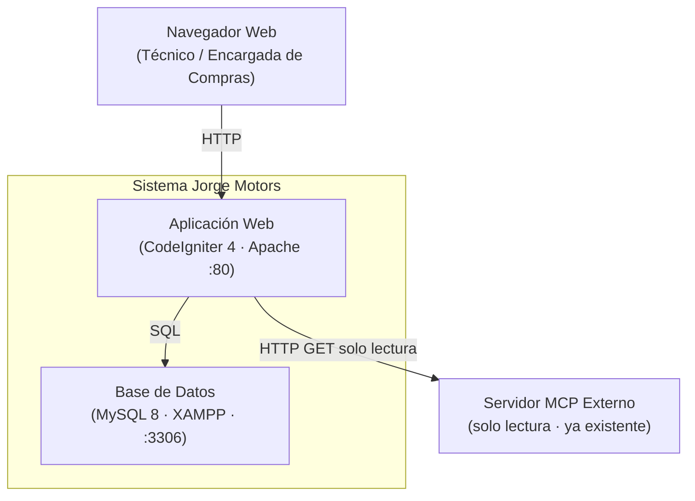
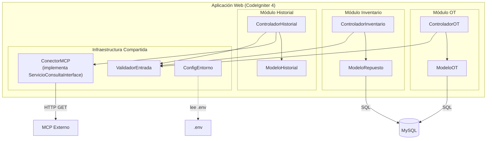
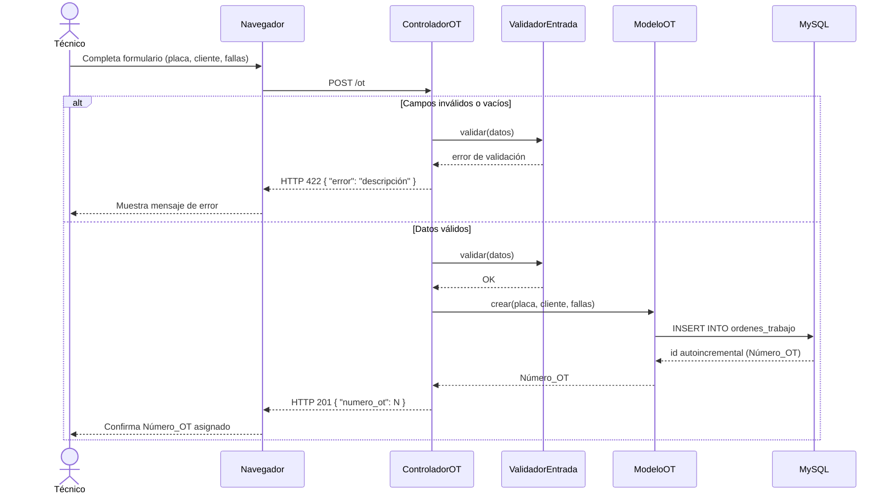
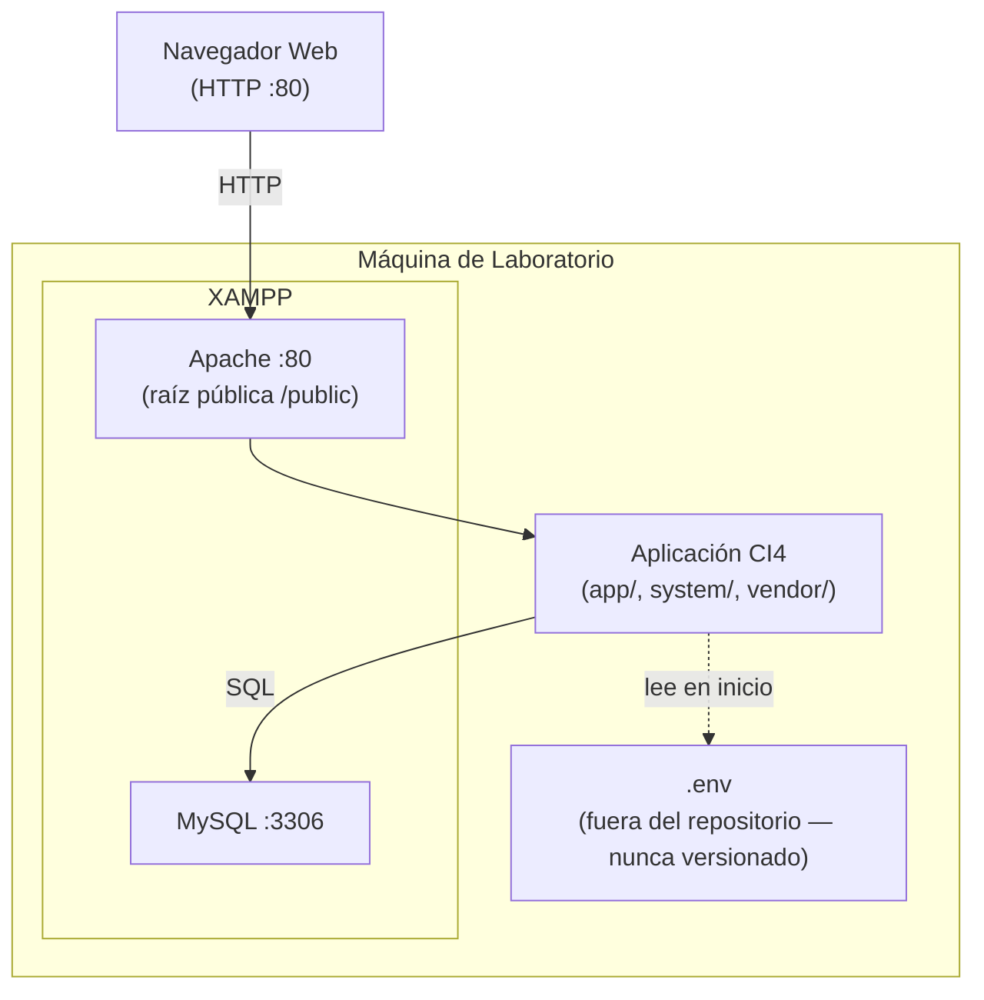

# Design Document

## Overview

Jorge Motors es un taller automotriz que gestiona Órdenes de Trabajo (OT) e inventario de repuestos de forma manual, generando descuadres de stock y demoras. Este sistema digitaliza ese proceso mediante una aplicación web construida con **CodeIgniter 4** (monolito modular por dominio), **MySQL 8** y **Apache**, todo sobre XAMPP.

Los usuarios son el **Técnico Mecánico** (registra OTs y consulta stock/historial) y la **Encargada de Compras** (gestiona despachos e ingresos de lotes). La aplicación persiste datos en MySQL y consume en modo solo lectura un servidor MCP externo ya existente para consultas de catálogo e historial vehicular. La integración activa con inteligencia artificial queda fuera del alcance de esta unidad; solo se define el punto de extensión arquitectónico correspondiente.

---

## Architecture

### Diagrama C4 Nivel 2 — Contenedores



### Diagrama C4 Nivel 3 — Componentes internos



### Diagrama de Secuencia — Registro de Orden de Trabajo (HU01)



### Diagrama de Despliegue



### Punto de extensión para la Unidad 3

El componente `ConectorMCP` implementa la interfaz `ServicioConsultaInterface`, que expone los métodos `buscarRepuestos(string $termino): array` y `obtenerHistorialVehicular(string $placa): array`. Los controladores dependen exclusivamente de esta interfaz, nunca de la implementación concreta. En la Unidad 3, un adaptador diferente (por ejemplo, uno que incorpore un agente o enriquezca las respuestas) podrá sustituir `ConectorMCP` mediante inyección de dependencia sin necesidad de modificar ningún controlador.

### Decisiones no tomadas

Las siguientes decisiones quedan pendientes para documentos y ADRs posteriores:

- **ADR-002** (pendiente): estrategia de migraciones de base de datos (herramienta y convención de versionado).
- **ADR-003** (pendiente): estructura y herramienta de pruebas, incluyendo la librería de property-based testing para PHP.
- **`modelo_datos.md`** (no creado): campos exactos, tipos, índices, restricciones de integridad y collation de cada tabla MySQL.
- **`structure.md`** (no creado): convención completa de carpetas y archivos del proyecto CI4.
- **Estrategia de autenticación y roles**: diferenciación entre Técnico Mecánico y Encargada de Compras (sesiones, tokens o similar).
- **Algoritmo de validación de documentos simulados**: lógica de dígito verificador para DNI (8 dígitos, RENIEC) y RUC (11 dígitos, SUNAT) usada en R7.

---

## Components and Interfaces

| Componente | Responsabilidad | Carpeta | Historias |
|---|---|---|---|
| `ControladorOT` | Recibe HTTP de creación y consulta de OT; orquesta validación y modelo | `app/Modules/OT/Controllers/` | HU01 (R1) |
| `ModeloOT` | Inserta y consulta registros de OT en MySQL | `app/Modules/OT/Models/` | HU01 (R1) |
| `ControladorInventario` | Gestiona endpoints de despacho y registro de lotes | `app/Modules/Inventario/Controllers/` | HU03 (R3), HU04 (R4) |
| `ModeloRepuesto` | Lee, crea y actualiza stock de repuestos; registra movimientos de inventario | `app/Modules/Inventario/Models/` | HU02 (R2), HU03 (R3), HU04 (R4) |
| `ControladorHistorial` | Recibe consultas de historial vehicular por placa; delega en `ConectorMCP` | `app/Modules/Historial/Controllers/` | HU05 (R5) |
| `ModeloHistorial` | Mapea datos devueltos por el MCP al dominio de la aplicación | `app/Modules/Historial/Models/` | HU05 (R5) |
| `ValidadorEntrada` | Valida placa (LLL-NNN), campos obligatorios, cantidades enteras positivas y datos de cliente simulados | `app/Libraries/` | R1, R2, R3, R4, R5, R7 |
| `ConectorMCP` | Adaptador HTTP de solo lectura al MCP externo; implementa `ServicioConsultaInterface` | `app/Libraries/` | HU02 (R2), HU05 (R5) |
| `ConfigEntorno` | Carga `.env`; falla explícitamente si `GEMINI_API_KEY` está ausente o vacía; enmascara el valor en logs | `app/Config/` | R6 |

**Interfaz clave:**

```php
// app/Libraries/ServicioConsultaInterface.php
interface ServicioConsultaInterface
{
    /**
     * Busca repuestos por término (1–100 chars).
     * Retorna array de ['codigo', 'nombre', 'stock'].
     */
    public function buscarRepuestos(string $termino): array;

    /**
     * Obtiene el historial vehicular de una placa.
     * Retorna array de ['id_ot', 'fecha', 'descripcion', 'tecnico'].
     */
    public function obtenerHistorialVehicular(string $placa): array;
}
```

---

## Data Models

### `ordenes_trabajo`

| Campo | Tipo | Notas |
|---|---|---|
| `id` | `INT UNSIGNED AUTO_INCREMENT` PK | Número_OT único |
| `placa` | `VARCHAR(10) NOT NULL` | Formato LLL-NNN |
| `cliente_simulado` | `VARCHAR(255) NOT NULL` | Datos ficticios (Ley 29733) |
| `descripcion_fallas` | `TEXT NOT NULL` | |
| `estado` | `ENUM('abierta','cerrada','cancelada') NOT NULL` | Default: `'abierta'` |
| `created_at` | `DATETIME NOT NULL` | UTC |

### `repuestos`

| Campo | Tipo | Notas |
|---|---|---|
| `id` | `INT UNSIGNED AUTO_INCREMENT` PK | |
| `codigo` | `VARCHAR(50) NOT NULL UNIQUE` | Clave de negocio |
| `nombre` | `VARCHAR(255) NOT NULL` | |
| `stock` | `INT UNSIGNED NOT NULL DEFAULT 0` | |
| `updated_at` | `DATETIME NOT NULL` | UTC |

### `movimientos_inventario`

| Campo | Tipo | Notas |
|---|---|---|
| `id` | `INT UNSIGNED AUTO_INCREMENT` PK | |
| `tipo` | `ENUM('despacho','ingreso') NOT NULL` | |
| `codigo_repuesto` | `VARCHAR(50) NOT NULL` | FK lógica a `repuestos.codigo` |
| `cantidad` | `INT UNSIGNED NOT NULL` | |
| `numero_ot` | `INT UNSIGNED NULL` | FK lógica a `ordenes_trabajo.id`; NULL en ingresos |
| `created_at` | `DATETIME NOT NULL` | UTC, formato ISO 8601 |

> Los campos exactos, índices, restricciones de integridad referencial y collation quedan detallados en `docs/arquitectura/modelo_datos.md` (pendiente de creación, obligatorio en el mismo commit que cada tabla nueva).

---

## Correctness Properties

*Una propiedad es una característica o comportamiento que debe cumplirse en todas las ejecuciones válidas del sistema — esencialmente, una afirmación formal sobre lo que el sistema debe hacer. Las propiedades sirven de puente entre las especificaciones legibles por humanos y las garantías de corrección verificables por máquina.*

---

### Property 1: Creación de OT con datos válidos asigna Número_OT único

*Para cualquier* combinación de placa válida (LLL-NNN), cliente simulado no vacío y descripción de fallas no vacía, el Sistema crea exactamente una OT, le asigna un Número_OT entero positivo y ese Número_OT no está asignado a ninguna OT creada anteriormente.

**Validates: Requirements 1.1, 1.6**

---

### Property 2: Campos obligatorios vacíos o solo-espacios son rechazados sin persistencia

*Para cualquier* solicitud de creación de OT o ingreso de Lote que tenga al menos un campo obligatorio (placa, cliente_simulado, descripcion_fallas, codigo_repuesto, nombre) con valor vacío o compuesto únicamente de espacios en blanco, el Sistema rechaza la operación sin crear ni modificar ningún registro en la base de datos.

**Validates: Requirements 1.3, 1.4, 1.8, 4.3, 4.5**

---

### Property 3: Placa con formato inválido es rechazada en cualquier operación

*Para cualquier* cadena que no cumpla estrictamente el patrón LLL-NNN (tres letras, guion, tres dígitos), el Sistema rechaza la solicitud — ya sea de creación de OT o de consulta de historial vehicular — con un mensaje que indica el formato esperado, sin realizar ninguna consulta al MCP ni persistir datos.

**Validates: Requirements 1.5, 5.6**

---

### Property 4: ConectorMCP solo emite operaciones HTTP GET

*Para cualquier* operación del Sistema que requiera consultar el MCP externo (búsqueda de repuestos o historial vehicular), el `ConectorMCP` emite exclusivamente solicitudes HTTP GET. Nunca emite POST, PUT, PATCH ni DELETE hacia el MCP.

**Validates: Requirements 2.2, 2.6, 5.5**

---

### Property 5: Término de búsqueda inválido es rechazado sin llamar al MCP

*Para cualquier* término de búsqueda que esté vacío o cuya longitud supere los 100 caracteres, el Sistema rechaza la consulta con un mensaje de error y no realiza ninguna llamada al MCP externo.

**Validates: Requirements 2.3**

---

### Property 6: Despacho válido reduce el stock exactamente y persiste el movimiento de forma atómica

*Para cualquier* repuesto con stock S y despacho C donde C es un entero positivo y C ≤ S, el Sistema reduce el stock del repuesto a exactamente S − C y persiste un movimiento de tipo `despacho` con el código del repuesto, la cantidad C, el Número_OT asociado y la marca de tiempo UTC. Ambos cambios se confirman juntos o ninguno se aplica.

**Validates: Requirements 3.1, 3.6**

---

### Property 7: Despacho con cantidad mayor al stock disponible es rechazado sin modificar datos

*Para cualquier* repuesto con stock S y despacho C donde C > S, el Sistema rechaza la operación sin modificar el stock ni crear ningún movimiento, y el stock permanece en S.

**Validates: Requirements 3.2**

---

### Property 8: Operación con referencia inexistente es rechazada sin modificar datos

*Para cualquier* operación de despacho que referencie un código de repuesto que no existe en la base de datos, o un Número_OT que no existe en la base de datos, el Sistema rechaza la operación sin modificar ningún dato.

**Validates: Requirements 3.3, 3.4**

---

### Property 9: Cantidad no positiva o no entera es rechazada en cualquier operación de inventario

*Para cualquier* cantidad que sea menor o igual a cero, o que no sea un número entero, el Sistema rechaza la operación de despacho o ingreso de lote sin modificar el stock ni crear movimiento alguno.

**Validates: Requirements 3.5, 4.4**

---

### Property 10: Despacho contra OT en estado no abierto es rechazado sin modificar datos

*Para cualquier* OT cuyo estado sea `cerrada` o `cancelada`, cualquier intento de despacho contra ella es rechazado sin modificar el stock del repuesto ni crear ningún movimiento.

**Validates: Requirements 3.7**

---

### Property 11: Lote válido incrementa el stock exactamente y persiste el movimiento de forma atómica

*Para cualquier* repuesto con stock S y lote L donde L es un entero positivo, el Sistema incrementa el stock del repuesto a exactamente S + L y persiste un movimiento de tipo `ingreso` con el código del repuesto, nombre, cantidad L y marca de tiempo UTC en formato ISO 8601. Ambos cambios se confirman juntos o ninguno se aplica.

**Validates: Requirements 4.1, 4.6**

---

### Property 12: Lote con código inexistente crea el repuesto con stock inicial igual a la cantidad

*Para cualquier* código de repuesto que no exista en la base de datos, nombre no vacío y cantidad L entera positiva, el Sistema crea el repuesto con `stock = L` y persiste el movimiento de ingreso correspondiente.

**Validates: Requirements 4.2**

---

### Property 13: Historial vehicular devuelve exactamente todos los registros de la placa

*Para cualquier* placa válida con N OTs registradas (N ≥ 1), la consulta de historial devuelve exactamente N registros, y cada registro contiene los campos: identificador de OT, fecha, descripción del trabajo realizado y técnico responsable.

**Validates: Requirements 5.1, 5.2**

---

### Property 14: Enmascaramiento de GEMINI_API_KEY en logs de error

*Para cualquier* clave `GEMINI_API_KEY` de longitud ≥ 5 caracteres, cuando el Sistema registra un error relacionado con la Gemini API, la entrada de log no contiene la clave completa — solo los primeros 4 caracteres seguidos de asteriscos.

**Validates: Requirements 6.5**

---

### Property 15: Rechazo de datos de cliente con documento de formato real

*Para cualquier* solicitud que incluya en el campo `cliente_simulado` un valor que supere la validación de formato de documento real (DNI de 8 dígitos o RUC de 11 dígitos), el Sistema rechaza la operación sin persistir el dato.

**Validates: Requirements 7.2, 7.4**

---

## Error Handling

Todos los errores retornan JSON con la estructura `{ "error": "descripción" }`.

| Escenario | Código HTTP | Comportamiento |
|---|---|---|
| Campo obligatorio vacío o solo-espacios | 422 | Mensaje identificando el campo; sin persistencia |
| Formato de placa inválido (no LLL-NNN) | 422 | Mensaje con formato esperado; sin consulta al MCP |
| Término de búsqueda vacío o > 100 caracteres | 400 | Mensaje de formato válido; sin llamada al MCP |
| Repuesto no encontrado en despacho | 404 | Mensaje de código inexistente; stock sin cambios |
| OT no encontrada en despacho | 404 | Mensaje de OT inexistente; stock sin cambios |
| Stock insuficiente para despacho | 409 | Mensaje con stock disponible actual |
| OT en estado `cerrada` o `cancelada` | 409 | Mensaje de estado; operación rechazada |
| MCP no disponible o timeout (> 1 s) | 503 | Mensaje de indisponibilidad; sin resultados parciales |
| Base de datos no disponible | 503 | Mensaje de error de persistencia |
| `GEMINI_API_KEY` ausente o vacía al arrancar | — | Fallo de inicio; log con nombre de variable (sin valor) |
| Intento de datos de cliente con documento real | 422 | Mensaje de política de datos simulados; sin persistencia |

### Reglas transversales de manejo de errores

- Los errores de validación (4xx) se generan en `ValidadorEntrada` antes de cualquier acceso a la base de datos.
- Los errores de disponibilidad (503) se capturan en los controladores mediante `try/catch` y nunca exponen trazas de pila al cliente.
- El valor de `GEMINI_API_KEY` nunca aparece en el cuerpo de ninguna respuesta HTTP ni en los logs; `ConfigEntorno` enmascara el valor mostrando como máximo los primeros 4 caracteres seguidos de asteriscos.
- Las operaciones de inventario (despacho e ingreso) se ejecutan dentro de una transacción MySQL; si la transacción falla, se ejecuta `ROLLBACK` antes de retornar el error.

---

## Testing Strategy

### Nivel 1 — Pruebas unitarias (PHPUnit)

Verifican comportamiento concreto de componentes individuales con ejemplos específicos:

- **`ValidadorEntrada`**: casos válidos e inválidos de placa (LLL-NNN y variantes), campos vacíos, solo-espacios, cantidades negativas/decimales/cero, documentos de cliente simulado vs. reales.
- **`ConfigEntorno`**: arranque con variable presente y válida, ausente, vacía.
- **`ConectorMCP`**: respuesta HTTP 200 con datos correctos, timeout simulado, error HTTP 4xx/5xx.
- **Enmascaramiento de clave**: para claves de distintas longitudes, verificar que el log contiene máximo 4 caracteres visibles + asteriscos.

### Nivel 2 — Pruebas de propiedades (PBT)

Una prueba de propiedad por cada propiedad definida en la sección *Correctness Properties*. Cada prueba genera entradas aleatorias y verifica que la propiedad se cumple en todas las variantes.

**Configuración obligatoria:**
- Mínimo **100 iteraciones** por prueba de propiedad.
- Cada prueba lleva un comentario de trazabilidad:
  `// Feature: gestion-taller-inventario, Propiedad N: <texto de la propiedad>`
- La librería de PBT para PHP queda por definir en **ADR-003** (pendiente).
- Las pruebas que involucran `ConectorMCP` o la base de datos usan **dobles de prueba** (mocks/stubs) para mantener las pruebas rápidas y deterministas.

Propiedades a cubrir (una prueba PBT cada una):

| N.º | Título | Requisitos |
|---|---|---|
| 1 | Creación de OT asigna Número_OT único | R1.1, R1.6 |
| 2 | Campos obligatorios vacíos/solo-espacios son rechazados | R1.3, R1.4, R1.8, R4.3, R4.5 |
| 3 | Placa inválida rechazada en cualquier operación | R1.5, R5.6 |
| 4 | ConectorMCP solo emite HTTP GET | R2.2, R2.6, R5.5 |
| 5 | Término de búsqueda inválido rechazado sin llamar al MCP | R2.3 |
| 6 | Despacho válido reduce stock exactamente (atómico) | R3.1, R3.6 |
| 7 | Despacho con C > S rechazado sin modificar datos | R3.2 |
| 8 | Referencia inexistente rechazada sin modificar datos | R3.3, R3.4 |
| 9 | Cantidad inválida rechazada en inventario | R3.5, R4.4 |
| 10 | Despacho contra OT no abierta rechazado | R3.7 |
| 11 | Lote válido incrementa stock exactamente (atómico) | R4.1, R4.6 |
| 12 | Lote con código nuevo crea repuesto con stock=L | R4.2 |
| 13 | Historial devuelve exactamente N registros con campos completos | R5.1, R5.2 |
| 14 | GEMINI_API_KEY enmascarada en logs de error | R6.5 |
| 15 | Documento real en cliente_simulado es rechazado | R7.2, R7.4 |

### Nivel 3 — Pruebas de humo e integración

Verifican el comportamiento del sistema completo con 1-3 ejemplos representativos:

- **Arranque**: sistema inicia correctamente con `GEMINI_API_KEY` presente y válida; falla con mensaje correcto si ausente o vacía.
- **Tiempos de respuesta**: creación de OT responde en < 2,0 s; búsqueda de repuestos en < 1,0 s (con MCP respondiendo normalmente).
- **Flujo OT → Despacho → Verificación de stock**: crear OT → despachar repuesto → consultar stock y confirmar reducción.
- **Timeout de MCP**: mock de MCP que demora > 1 s; verificar que el sistema retorna 503 sin datos parciales.
- **Seed data**: verificar que todos los registros iniciales contienen prefijos ficticios y documentos que no pasan la validación de formato real.
